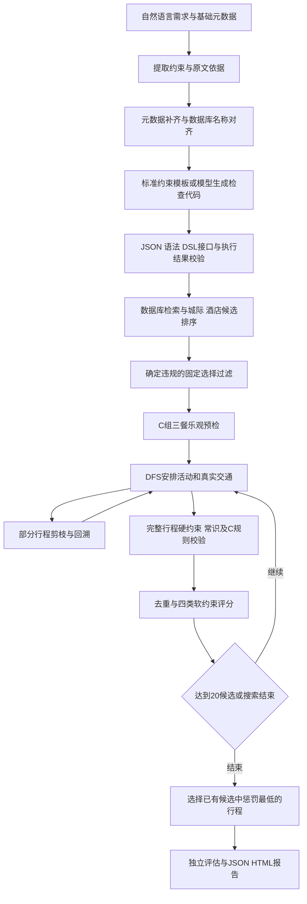

# ShortTrip

ShortTrip 基于 ChinaTravel 的 LLMNeSy 架构，将自然语言需求转换成可执行约束，结合本地旅游数据库、深度优先搜索（DFS）、硬约束剪枝和软约束评分，生成完整旅游行程。

当前完整实验入口采用 C 组规则，覆盖三餐、景点营业时间、跨午夜日期、交通选择和费用检查。搜索收集最多20个通过校验的不同候选，再选择软约束惩罚最低的行程，输出 JSON 和完整行程 HTML。

当前代码的主要扩展包括约束翻译修复、灵活三餐顺序、提前剪枝、四类软评分与候选选优。用户画像和个性化评分处于设计阶段。

## 内容导航

- [架构总览](#架构总览)
- [模块与职责](#模块与职责)
- [约束翻译](#约束翻译)
- [数据库与模型推荐](#数据库与模型推荐)
- [DFS与提前剪枝](#dfs与提前剪枝)
- [三餐日期与景点规则](#三餐日期与景点规则)
- [软约束与候选选优](#软约束与候选选优)
- [安装与运行](#安装与运行)
- [输出与诊断](#输出与诊断)
- [测试与验证](#测试与验证)
- [当前边界](#当前边界)

## 架构总览

以下流程对应 `experiments/c_only/` 的完整 C 组运行入口。



大模型负责需求理解、复杂约束代码生成，以及交通、酒店、景点、餐厅和下一活动类型的推荐。程序负责执行数据库查询、时间与费用计算、搜索回溯、约束检查和最终评分。模型推荐结果经过后续搜索和校验后才成为有效行程。

## 模块与职责

| 目录或文件 | 职责 |
| --- | --- |
| `chinatravel/agent/llms.py` | 模型客户端及 OpenAI 兼容接口配置 |
| `chinatravel/agent/nesy_agent/nesy_agent.py` | 规划主流程、外层交通与酒店组合、基础 DFS、完整约束验证和剪枝接入 |
| `chinatravel/agent/nesy_agent/llm_driven_rec.py` | 模型驱动的候选推荐、活动类型选择及排序 |
| `chinatravel/agent/nesy_agent/prompts/` | 中英文提示词与本地执行语义 |
| `chinatravel/agent/nesy_agent/nl2sl_hybrid.py`、`nl2sl_hybrid_en.py` | 中英文自然语言到符号约束的翻译流程 |
| `chinatravel/agent/nesy_agent/extraction_alignment.py` | 原文覆盖检查、偏差修复、名称别名对齐和已验证约束锁定 |
| `chinatravel/agent/nesy_agent/constraint_compiler.py` | 标准约束的确定性检查代码模板 |
| `chinatravel/agent/nesy_agent/translation_contract.py` | 翻译输出结构、DSL接口及布尔结果校验 |
| `chinatravel/agent/nesy_agent/pruning.py` | 固定选择与部分行程的必要条件检查 |
| `chinatravel/environment/` | 城际交通、景点、酒店、餐厅、市内交通工具及沙盒数据访问 |
| `chinatravel/symbol_verification/` | 符号概念、受限 DSL 执行和规划内部验证 |
| `chinatravel/soft_constraints/agent.py` | 扩展搜索，使其持续收集可行候选并选择最终结果 |
| `chinatravel/soft_constraints/pool.py` | 候选快照、指纹去重、数量上限和最优候选选择 |
| `chinatravel/soft_constraints/scoring.py` | 四类软约束的指标、惩罚、权重与明细 |
| `experiments/c_only/experiment_agent.py` | C组三餐、日期、交通时间偏好和搜索钩子 |
| `experiments/c_only/dfs_snapshot.py` | 带C组活动安排与用餐检查钩子的 DFS 实现 |
| `experiments/c_only/rules.py`、`catalog.py` | 绝对日期、用餐机会、景点时间审核及交通时长查询 |
| `experiments/c_only/meal_pruning.py` | 进入详细 DFS 前的三餐时间及最低餐费检查 |
| `chinatravel/evaluation/` | 独立的输出结构、常识与用户硬约束评估 |
| `experiments/c_only/prepare.py`、`worker.py`、`driver.py`、`report.py` | 十例实验准备、单例执行、进程协调和 HTML 报告 |
| `reproduction/` | 原版复现入口、四类软约束入口、评估与渲染工具 |
| `agent_env/` | 供外部 Agent 使用的 Python、CLI、MCP 和 HTTP 环境接口 |
| `synthetic_query_generation/` | 根据有效种子行程生成并审核合成约束查询 |
| `tests/`、`experiments/c_only/test_*.py` | 离线回归测试 |

其他规划算法保留在 `chinatravel/agent/` 下。此 README 的主流程使用 LLMNeSy 和 C 组扩展。

## 约束翻译

翻译将用户原文和元数据转换为 `hard_logic` 及对应的 `hard_logic_py`，随后进入搜索。

| 阶段 | 当前处理 |
| --- | --- |
| 元数据补齐 | 根据天数、人数生成基础检查，推导票数和出租车数量，房间数依据明确要求处理 |
| 原文依据 | 非派生约束附带用户原文，检查凭空增加的预算、房间和床型要求 |
| 覆盖检查 | 为可识别的明确地点、类别、预算、交通及返程要求建立清单，发现遗漏后修复提取 |
| 数据库对齐 | 校验实体名称与类别，处理别名，未指定校区的同一大学保留多个校区选项 |
| 模板编译 | 天数、人数、预算、房型、地点、交通类型、G字头及返程截止等标准约束使用模板 |
| 复杂代码生成 | 模板覆盖之外的约束由模型生成检查代码，再执行校验与有限次修复 |
| 输出契约 | 检查 JSON、代码字符串、AST、DSL接口和显式布尔结果 |

本地端点支持约束代码输出的 JSON Schema。已经验证的约束和程序在修复时保留，连续修复仍失败的输入会在进入 DFS 前报告错误。

C组实验将数据集提供的答案约束字段从规划输入中移除。独立评估阶段再使用这些字段，规划阶段使用从原文重新翻译的约束。

## 数据库与模型推荐

沙盒提供中文和英文数据版本，包含城市之间的火车、飞机，以及各城市的景点、酒店、餐厅和市内交通查询能力。实体名称、价格、营业时间和交通结果来自数据库工具。

模型输出候选推荐后，程序结合价格、距离等因素形成探索顺序。外层搜索依次尝试去程、返程和酒店组合，内层 DFS 再安排每日活动。某个组合内部回溯结束后，可以继续尝试其他组合。

市内交通以 `metro`、`taxi`、`walk` 为基础方式。当前版本保留模型给出的合法顺序，并补齐其他硬约束允许的方式。地铁接驳步行按照现有验证器的主要交通方式语义处理。

## DFS与提前剪枝

DFS逐步加入餐饮、景点、酒店和返程活动，失败时撤回活动并尝试其他分支。提前剪枝依据已经确定的事实及必要条件。

| 检查位置 | 可提前拒绝的情况 |
| --- | --- |
| 去程或返程候选 | 已选交通违反允许类型、火车字头或明确返程出发截止时间 |
| 两程确定后 | 交通类型集合与完整要求不符，或在C组日期检查中出现行程顺序冲突 |
| 酒店确定后 | 明确房型、房间数或价格限制与已选酒店冲突 |
| 固定组合进入C组DFS前 | 即使按零通勤、允许复用餐厅的乐观条件，也无法安排必需三餐 |
| 部分行程 | 已发生的票数、车辆数、餐费等违规，以及费用下界超过预算 |
| 交通时间 | 所有允许的交通方式均赶不上酒店或返程截止 |
| 景点安排 | 到达时闭馆、超过日间限制，或参观后无法完成必需用餐 |

费用下界合并去返程、应住酒店夜数、已发生活动及市内交通费用，预留与实际费用避免重复计数。跨午夜去程占用的夜晚会减少预留酒店夜数。C组预检还计入必需用餐最低费用。

未知路线或未知营业信息保留分支。尚未访问的必去景点、尚未满足的未来类别，以及自定义复杂约束，按其可判定阶段继续检查。完整行程仍执行全部约束验证。

## 三餐日期与景点规则

| 项目 | C组当前规则 |
| --- | --- |
| 早餐开始窗口 | 06:00 ≤ 开始时间 < 09:00，时长至少30分钟 |
| 午餐开始窗口 | 11:00 ≤ 开始时间 < 14:00，时长至少60分钟 |
| 晚餐开始窗口 | 17:00 ≤ 开始时间 < 20:00，时长至少60分钟 |
| 旅行边界 | 去程交通出发至返程交通到达 |
| 用餐适用性 | 根据旅行边界、实际城际交通占用和完整用餐机会判定必需、边界不适用或交通豁免 |
| 灵活顺序 | 保留先景点后吃饭、先吃饭后景点两种分支 |
| 用餐可行性 | 检查真实接驳、餐厅营业时间、完整用餐时长及城际交通冲突 |
| 酒店早餐 | 需要实际前一晚住宿记录，并且08:00—08:30落在有效机会内 |
| 景点时间 | 安排在08:00—21:00，并满足实际营业时间 |
| 景点候开等待 | 当前C组保留最多60分钟的等待门槛 |
| 城际时间偏好 | 优先早上去程、晚上返程，受硬约束过滤与实际班次可用性限制 |

三餐窗口约束开始时间，完整用餐还要处于合法空闲区间及餐厅营业区间内。交通豁免依据实际城际交通占用，接驳和候车时间单独计算。

日期模块结合班次时刻与沙盒 `Duration` 处理跨午夜、超过一天的交通及接驳记录。明显冲突的数据会在日期校验阶段处理。

## 软约束与候选选优

通过完整校验的行程进入 `CandidatePool`，计算以下四类惩罚。

| 评分类别 | 主要指标 |
| --- | --- |
| 交通合理性 `transport` | 单次长通勤、单段长步行、车站或机场长等待 |
| 每日节奏 `rhythm` | 日内过忙、活动跨度过长、长空档、游玩时间不足及缺餐 |
| 跨日分布 `distribution` | 有足够可游玩时间的一天缺少景点 |
| 路线效率 `efficiency` | 每日市内交通总时长、总距离、为用餐增加的绕路 |

`SoftConfig` 保存阈值与权重。当前默认四类权重均为1，部分默认值如下。

| 参数 | 默认值 |
| --- | --- |
| 单次通勤惩罚起点 | 60分钟 |
| 单段步行惩罚起点 | 20分钟 |
| 车站、机场等待惩罚起点 | 90分钟、180分钟 |
| 单段空档惩罚起点 | 120分钟 |
| 每日市内交通惩罚起点 | 120分钟、30公里 |
| 用餐绕路惩罚起点 | 15分钟、3公里 |

这些默认值用于软评分。C组用餐、日期和营业时间检查另外执行。

候选指纹基于完整行程快照。相同快照只保留一次，时间或记录不同的相似路线仍可能进入候选池。最终选择累计软惩罚最低的候选，同分时优先较早收集的候选。

达到20个候选后结束收集。时间预算用尽或搜索结束时，使用已经找到的可行候选进行选优。实际候选数和终止原因写入结果。

## 安装与运行

### 环境准备

使用 Python 3.12 或更新版本，从仓库根目录运行。当前完整 C 组批次控制器使用 Windows 进程及电源管理接口，发布前验证环境为 Windows。

```powershell
git clone https://github.com/Paddington633/ShortTrip.git
cd ShortTrip
python -m venv .venv
.\.venv\Scripts\Activate.ps1
python -m pip install -r requirements.txt
python scripts/bootstrap_data.py --lang both
```

`bootstrap_data.py` 按 `data_sources.json` 固定的数据修订下载沙盒和 easy、medium、human 输入，校验沙盒压缩包哈希并检查解压路径。大型数据保存在本地 Git 忽略目录。

### 本地Qwen十例入口

本地服务由使用者单独部署。当前实验配置采用 Qwen3.5-4B Q8、16K上下文、关闭思考，提供 OpenAI 兼容 Chat Completions 服务。

| 配置项 | 当前值 |
| --- | --- |
| 服务地址 | `http://127.0.0.1:18080/v1` |
| 模型别名 | `qwen3.5-4b-q8` |
| 案例 | 仓库固定 easy、human 各5例，每例1次 |
| 并行数 | 1 |
| 候选目标 | 每例20个 |
| 内部墙钟预算 | 1750秒，在检查点生效 |
| 外部进程限时 | 1800秒，结束后另有结果整理与评估 |
| 请求超时与重试 | 600秒，HTTP重试次数0 |
| 单次最大输出 | 4096 tokens |

启动本地模型服务后执行以下命令。

```powershell
python experiments/c_only/prepare.py
python experiments/c_only/driver.py
```

`prepare.py` 生成配置、源码哈希和提示词快照。`driver.py` 启动单例进程、处理外部超时并更新报告。`worker.py` 负责约束翻译、候选搜索、结果保存和独立评估。

已有准备文件会触发保护，已有案例结果会保留。需要重新实验时使用新的仓库工作副本，并重新准备运行配置。修改已固定哈希的源码后也应重新准备。

### 其他入口

| 入口 | 用途 |
| --- | --- |
| `run_exp.py` | 原有多算法规划入口 |
| `reproduction/prepare.py`、`reproduction/run.py` | easy、medium、human 固定样例的通用API复现 |
| `reproduction/soft_constraints/run.py` | 四类软约束候选选优入口 |
| `eval_exp.py`、`chinatravel/evaluation/` | 原有独立评估 |
| `agent_env/` | 外部Agent调用环境的工具接口 |

通用API复现读取根目录等位置的 `.env.local`。可从 `.env.example` 创建本地配置，设置 `CHINATRAVEL_OPENAI_API_KEY`、`CHINATRAVEL_OPENAI_BASE_URL` 和 `CHINATRAVEL_OPENAI_MODEL`。当前模板模型名为 `deepseek-flash`。各入口使用各自准备文件，具体参数见对应脚本和文档。本地C组入口显式设置回环服务配置。

## 输出与诊断

| 路径 | 内容 |
| --- | --- |
| `experiments/c_only/itineraries.html` | 完整每日行程和案例状态 |
| `results/<case>.json` | 最终选出的行程及运行指标 |
| `candidates/<case>.json` | 已收集候选、评分、指纹与校验标记 |
| `selection/<case>.json` | 最优候选、惩罚、重复数量、终止原因及剪枝诊断 |
| `status/<case>.json` | 翻译或搜索阶段、模型调用数、候选数及错误信息 |
| `evaluation/<case>/` | 原版输出结构、常识和用户硬约束评估 |
| `traces/<case>.jsonl` | 本地模型请求、响应或错误记录 |
| `logs/<case>.log` | 搜索和校验日志 |
| `summary.json`、`all_results.json` | 批次统计和汇总 |
| `process_exits.json` | 单例进程退出信息 |
| `manifest.json` | 输入、模型参数、源码和运行脚本哈希 |

除首行完整 HTML 路径外，表内路径均相对于 `experiments/c_only/`。运行生成的数据由 Git 忽略。重新渲染已保存结果可执行以下命令。

```powershell
python experiments/c_only/report.py
```

日志中的 `PRUNE` 记录规则、约束及上下文。每种规则保留前三个示例，累计次数保存到 `prune_counts`，示例保存到 `prune_examples`。

| 状态 | 含义 |
| --- | --- |
| `generated` | 找到可行候选，评估结果另外记录 |
| `timed_out_with_candidates` | 达到时间预算，已找到部分候选并执行选优 |
| `timed_out_no_candidates` | 达到时间预算，尚未找到可行候选 |
| `no_feasible_candidate` | 本次搜索结束时未得到可行候选 |
| `failed` | 翻译、模型请求、执行或其他异常 |

分析批次进度时应结合进程存活、退出记录和日志，核对保存的 `running` 状态。

## 测试与验证

下载沙盒后，从仓库根目录运行离线测试。

```powershell
python -m unittest discover -s tests -p "test_*.py"
python -m unittest discover -s experiments/c_only -p "test_*.py"
```

2026-11-09发布验证包含126项项目测试和43项C规则测试，共169项通过。覆盖翻译契约、原文对齐、标准模板、三餐顺序、日期、剪枝边界、交通替代方式、原版评估及Windows进程树终止。

发布前还检查了149个Python文件的语法，在全新临时副本验证十例准备与HTML渲染，并扫描配置密钥和运行输出。Windows进程树测试需要具备终止自身子进程的执行权限。具体记录见 [VERIFICATION.md](VERIFICATION.md)。

## 当前边界

- 约束覆盖清单识别有限的标准表达。复杂或模糊需求仍受模型提取与翻译能力影响。
- 乐观三餐预检使用零通勤和宽松复用条件，通过后仍需真实路线搜索。
- DFS受探索顺序和时间预算影响，可能超时或收不满20个候选。
- 完整记录去重允许语义相近的候选。后续多样性改进仍需独立验证。
- 当前景点时长选择函数以90分钟为起点，实际安排会受到营业时间和日间边界限制。
- 数据库为固定版本沙盒，班次、价格和营业时间反映该数据版本。
- 个性化模块已有画像、偏好排序及评分方案，代码实现属于后续工作。

## 进一步阅读与来源

| 文档 | 内容 |
| --- | --- |
| [ARCHITECTURE.md](ARCHITECTURE.md) | 架构摘要 |
| [docs/translation-alignment.md](docs/translation-alignment.md) | 翻译修复范围 |
| [docs/flexible-meals.md](docs/flexible-meals.md) | 灵活三餐设计 |
| [docs/pruning.md](docs/pruning.md) | 剪枝条件和诊断 |
| [agent_env/README.zh-CN.md](agent_env/README.zh-CN.md) | 环境工具接口 |
| [synthetic_query_generation/README.zh-CN.md](synthetic_query_generation/README.zh-CN.md) | 合成数据生成流程 |
| [README.upstream.md](README.upstream.md)、[README.upstream.zh-CN.md](README.upstream.zh-CN.md) | 原项目说明及来源 |

项目保留 ChinaTravel 原有代码与来源说明，许可见 [LICENSE](LICENSE)。
